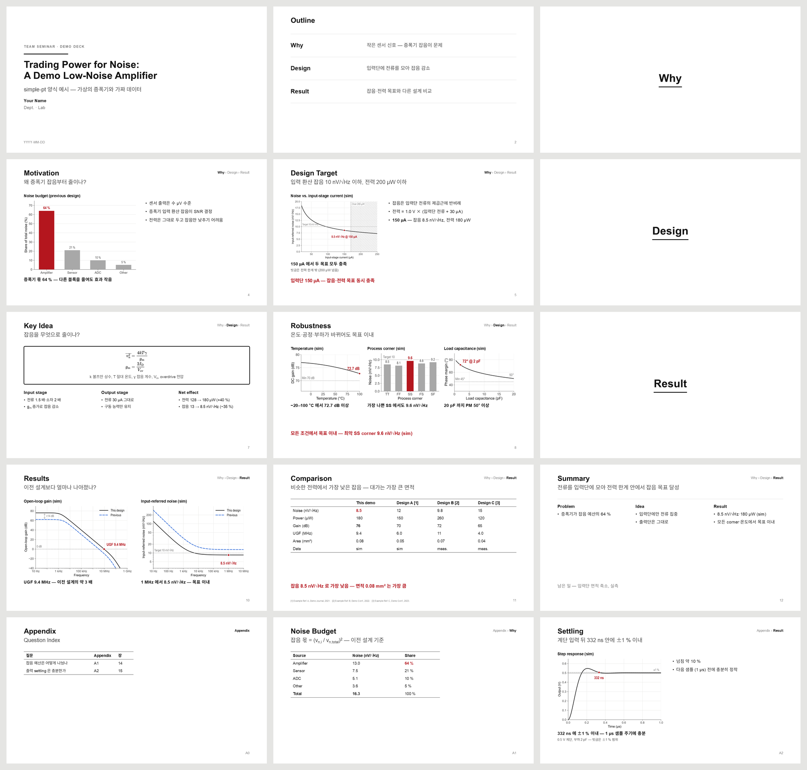

# simple-pt — "Simple is best" 발표 자료 양식

- 짧은 영어 제목 + 질문·평서문을 섞은 부제 (음슴체), 그림 중심 (카드·회색 상자 없음, 논문식 표), 빨간 결론 줄은 파트를 맺는 장에만, IEEE 표기 식, 근거는 Appendix.
- 디자인을 코드 (`tools/simple_pt.py`, python-pptx) 에 넣어서, "이 양식으로 PT 만들어줘" 라고만 해도 같은 모양의 pptx 가 나온다.
- Claude Code 를 기준으로 썼다 (skill). Codex 는 `AGENTS.md` 를 읽고 같은 파일을 따른다. 그래프는 함께 쓰는 저장소 [figstyle](https://github.com/Coxwoo/figstyle-jsw).
- 이전 양식 (모든 장의 빨간 줄, 회색 카드·표) 은 태그 `v1` 에 남아 있다 — `git checkout v1` 또는 GitHub 의 Tags 에서 zip.



## 목차

1. 파일 — 무엇이 어디에
2. 설치 — 처음 한 번
3. Claude Code 에서
4. Codex 에서
5. 직접 — Python
6. 식
7. 규칙 한눈에
8. 예시 덱
9. 라이선스

---

## 1. 파일

| 파일 | 내용 |
|---|---|
| `SKILL.md` | Claude Code skill — 준비, 만드는 순서, 꼭 지킬 것 |
| `CLAUDE.md` | 이 저장소를 Claude Code 로 열었을 때 |
| `AGENTS.md` | Codex 용 안내 — 같은 파일을 따르고, Claude Code 전용인 부분은 Codex 가 판단 |
| `check_setup.py`, `requirements.txt` | 설치 확인 — Python 패키지·글꼴·figstyle·장 그림 도구 |
| `rules/design.md` | 모양 — 캔버스·글꼴·크기·색·면과 선·레이아웃 |
| `rules/writing.md` | 글 — 제목·부제·결론 줄·빨간 줄·캡션·인용, 음슴체, 숫자, 노트 |
| `rules/structure.md` | 구성 — 흐름, 파트, 장 수, Appendix, 만드는 순서 |
| `rules/equations.md` | 식 — IEEE 표기, 만들기, 슬라이드에 넣기, 검산 |
| `rules/checklist.md` | 검수 목록 |
| `tools/simple_pt.py` | pptx 를 만드는 모듈 — 디자인 값의 정본 |
| `tools/equations.py`, `tools/mathjax/` | LaTeX 식 → SVG·PNG·TeX (MathJax 3.2.2) |
| `tools/fix_pptx.py` | 다른 도구로 만든 pptx 의 후처리 — 한글 글꼴·줄바꿈·아래 첨자·노트 지우기 |
| `example/` | 예시 덱 — `make_example.py`, `demo_amp.pptx`, 그림 (큰 글자 판 `figures/big/`), 식, 미리보기 |

## 2. 설치 — 처음 한 번

```bash
python check_setup.py              # 무엇이 있고 무엇이 빠졌는지
python check_setup.py --install    # 빠진 Python 패키지 설치 + matplotlib 글꼴 목록 새로 만들기
```

- Python 3.9 이상. 패키지는 `requirements.txt` (python-pptx, Pillow, lxml, matplotlib, numpy, PyMuPDF).
- 식에는 Node.js (LTS, [nodejs.org](https://nodejs.org)) — `--install` 이 `tools/mathjax` 에 MathJax 3.2.2 를 받는다 (`npm ci`).
- 글꼴: Arial (영문), Noto Sans KR (한글 — [Google Fonts](https://fonts.google.com/noto/specimen/Noto+Sans+KR) 에서 static 판), Arial Narrow (그래프 안 글자 — Office 와 함께), Times New Roman (글 속 τ 한 글자). 없으면 다른 글꼴로 바뀌어 모양·줄바꿈이 달라진다.
- 장을 그림으로 확인하려면 PowerPoint (Windows) 나 LibreOffice.

## 3. Claude Code 에서

```bash
git clone https://github.com/Coxwoo/simple-pt-jsw.git ~/.claude/skills/simple-pt
git clone https://github.com/Coxwoo/figstyle-jsw.git ~/.claude/skills/figstyle
```

- 그 뒤 어느 프로젝트에서든 "simple-pt 양식으로 PT 만들어줘". 처음이면 Claude 가 `check_setup.py` 로 설치부터 확인한다.
- 이 저장소 폴더를 Claude Code 로 열면 `CLAUDE.md` 가 `SKILL.md` 를 가리킨다.

## 4. Codex 에서

- 이 저장소 폴더 (와 figstyle) 를 받아 그 폴더에서 Codex 를 열고 "이 양식으로 PT 만들어줘".
- Codex 는 `AGENTS.md` 를 읽고 `SKILL.md`·`rules/` 를 그대로 따른다. Claude Code 에만 있는 부분 (skill 폴더 등) 은 Codex 가 환경에 맞게 판단한다.

## 5. 직접 — Python

```bash
python example/make_example.py          # example/demo_amp.pptx
```

```python
import sys
sys.path.insert(0, "tools")
from simple_pt import Deck

d = Deck("My Talk", parts=["Why", "Design", "Result"])     # parts — 오른쪽 위 진행 표시 (선택)
d.cover("Short Topic:\nWhat It Does", subtitle="한 줄 부제",
        name="Your Name", affiliation="Dept. · Lab", date="YYYY-MM-DD")
d.divider("Result")                                         # 파트 구분 장 (선택)
d.panels("Results", "이전 설계보다 무엇이 나아졌나?", part="Result",
         panels=[{"label": "Gain (sim)", "image": "figures/gain.png",
                  "takeaway": "UGF 약 3 배", "caption": "1.0 V, 27 °C"}],
         key="두 목표 모두 충족 (sim)", notes="말할 대본")   # key (빨간 줄) 는 파트를 맺는 장에만
d.save("my_talk.pptx")                  # 규칙에 어긋난 곳은 경고로 알려 준다
```

## 6. 식

```bash
python tools/equations.py "A_{v} = g_{\mathrm{m}} R_{\mathrm{L}}" -o figures/eq/gain     # SVG·PNG·TeX
```

- 엔진은 MathJax 3 (3.2.2 로 고정) — 글꼴 없이 어느 PC 에서나 같은 그림. SVG 는 IEEE 본문 10 pt, PNG 는 슬라이드용 1.6 배.
- 슬라이드에는 `d.equation(...)` — 채움 없는 검정 2¼ pt 상자 가운데 (`box=False` 면 상자 없이), 번호 없음, 아래 where 한 문장. 여러 줄은 맞출 자리에 `&` (aligned).
- IEEE 표기와 자세한 쓰는 법은 `rules/equations.md`.

## 7. 규칙 한눈에

| 글 | 규칙 |
|---|---|
| 제목 | 짧은 영어 주제 2–4 단어 |
| 부제 | 질문이나 결론 한 문장 — 덱 전체에서 섞음, 음슴체·단정형 |
| 그림 아래 | 결론은 굵은 한 줄, 조건·세부는 회색 캡션 |
| 빨간 줄 | 파트를 맺는 장에만, 굵은 결론 한 줄 |
| 표 | 논문식 — 채움·세로선 없이 위·아래 굵은 선 |
| 식 | IEEE 표기, 본문에는 확실한 식만, 번호 없음 |

- 흑백 미니멀, 강조는 빨강 하나. 카드·회색 상자·큰 숫자 타일·단계 번호·모든 장에 같은 틀을 쓰지 않는다 — AI 가 만든 장처럼 보인다.
- 그림마다 무엇을 어떤 조건으로 잰 것인지 보이게. 측정과 sim 을 섞지 않는다. 인용은 [n] + 아래 작은 글씨 (출처 줄·"Next:" 연결 문장은 쓰지 않는다).
- 노트: 본문은 말할 대본만, Appendix 는 질문 받을 때 말할 거리.

## 8. 예시 덱

- `example/demo_amp.pptx` — 가상의 증폭기 "Demo Amp", 가짜 데이터. 표지 → 목차 → 파트 (Why·Design·Result) 마다 구분 장과 본문 (식 장 포함, 빨간 줄은 파트를 맺는 세 장에만) → 요약 → Appendix 색인 → A1·A2.
- 장마다 뽑은 그림은 `example/preview/` (PowerPoint 로 뽑음).

## 9. 라이선스

MIT — `LICENSE`.
